# 🍴 Food Ordering & Table Booking App

A **Flutter + Firebase** powered application inspired by Swiggy, designed to provide seamless food ordering and restaurant table booking experiences.  
This project includes both a **User App** (Android/iOS) and an **Admin Panel** (Flutter Web) for complete real-time management.

---

## 🚀 Features

### User App
- Browse restaurants and menus
- Add items to cart & place orders
- Secure checkout with payment integration
- Book restaurant tables in real-time
- Receive push notifications for order status
- Wallet system with reward credits
- Achievements to enhance engagement

### Admin Panel (Flutter Web)
- Manage restaurants and menus dynamically
- Track and update orders in real-time
- Handle table reservations
- Manage customers and rewards system

---

## 🛠️ Tech Stack

- **Frontend:** Flutter (Mobile + Web)
- **State Management:** Riverpod
- **Backend & Database:** Firebase Firestore
- **Authentication:** Firebase Auth
- **Cloud Storage:** Firebase Storage
- **Push Notifications:** Firebase Cloud Messaging (FCM)
- **Payments & Wallet:** Custom credit wallet system
- **Other Tools:** Dart, CI/CD, GitHub

---

## 📱 Screenshots & Demo
*(Add screenshots or demo video here once available)*
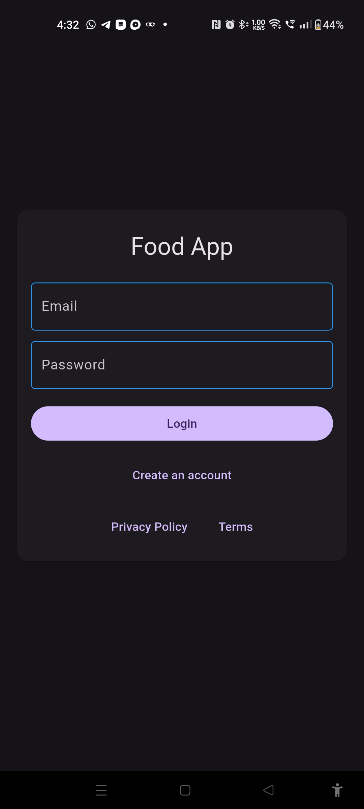

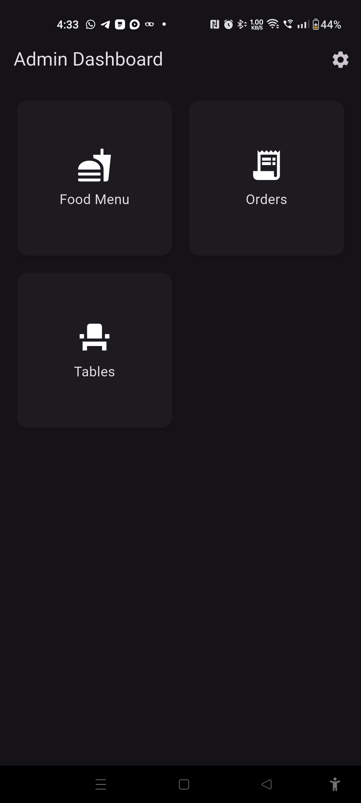
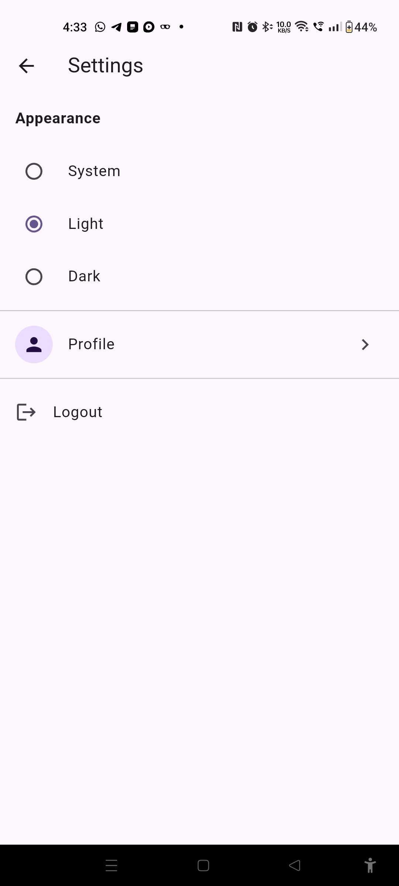
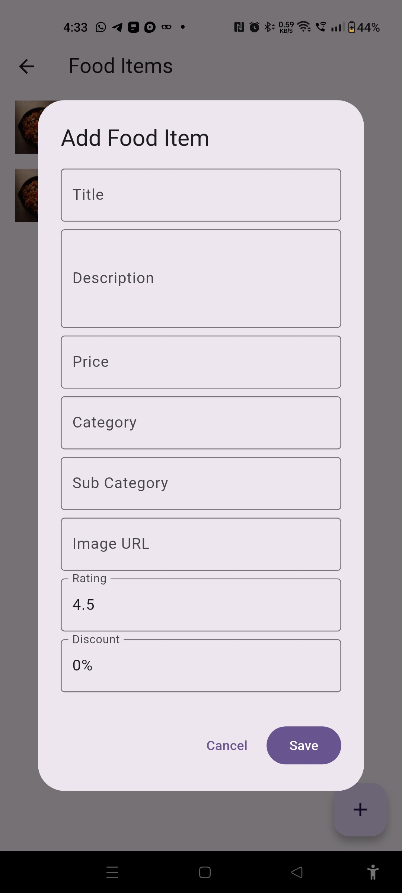
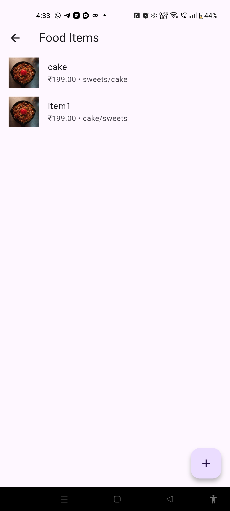
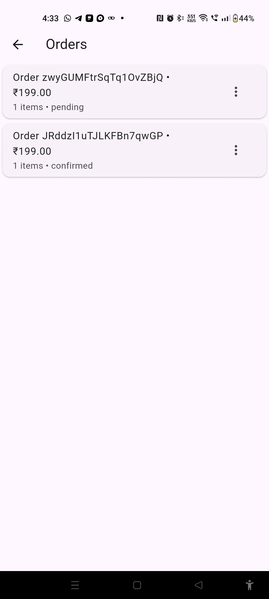
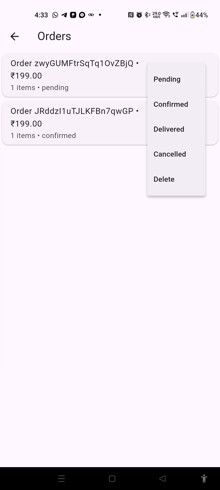
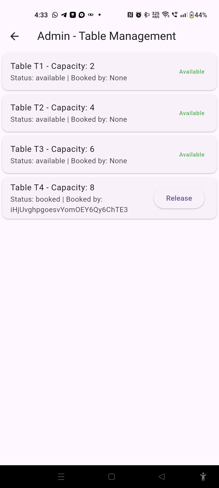


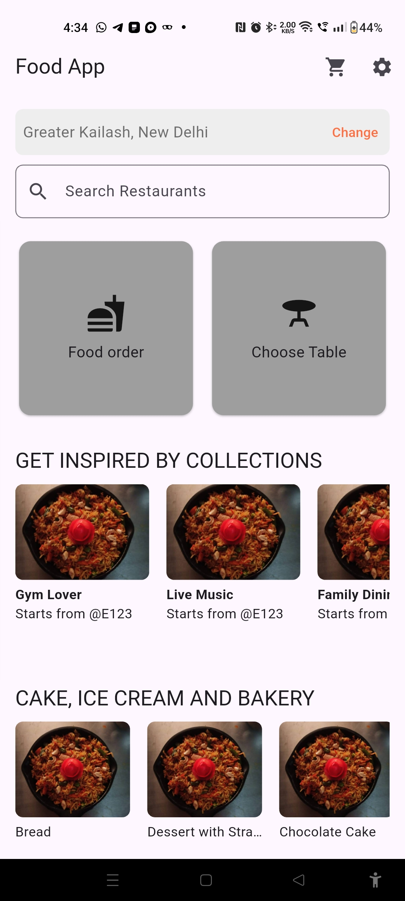
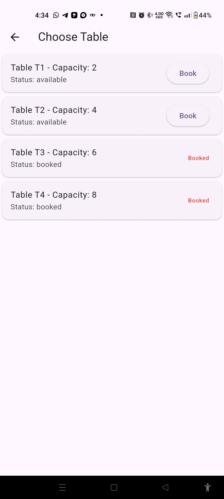
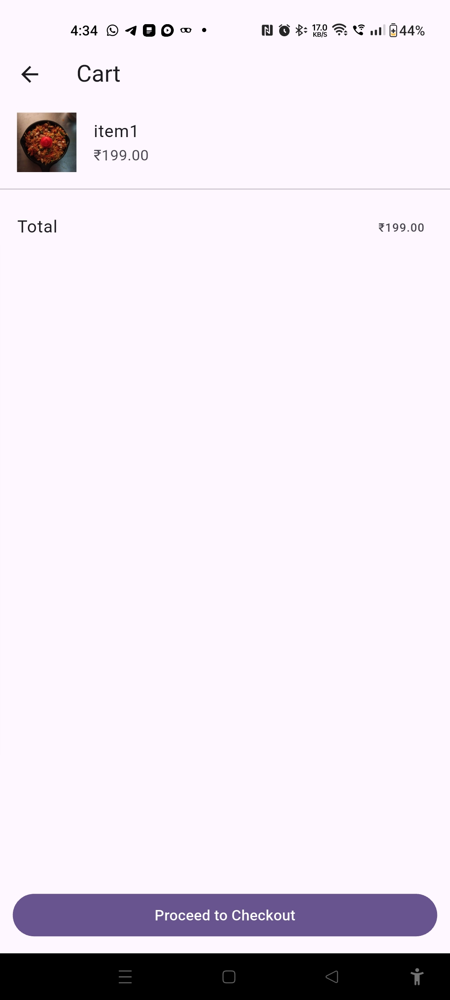
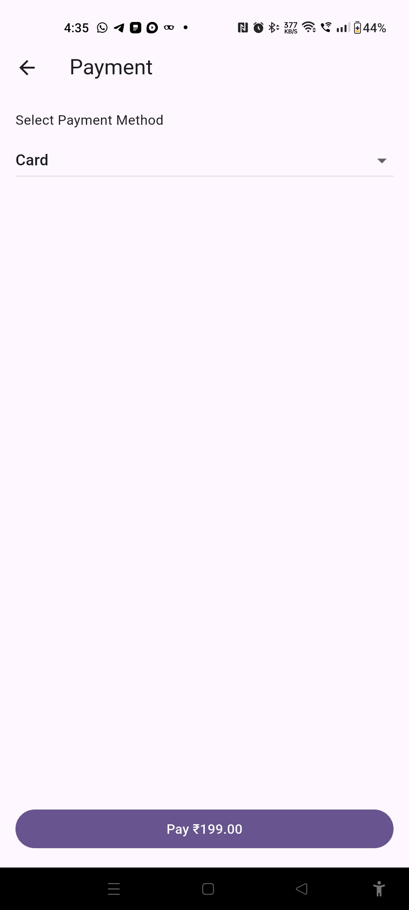
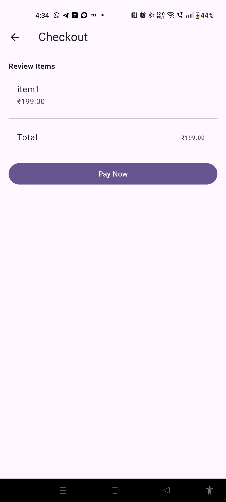
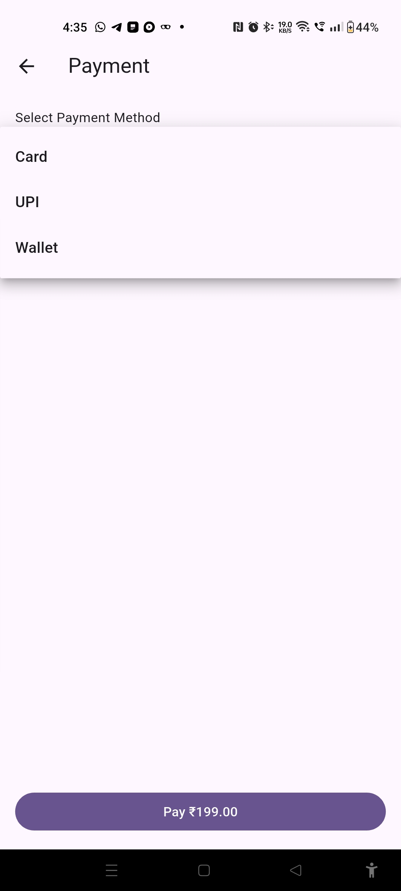
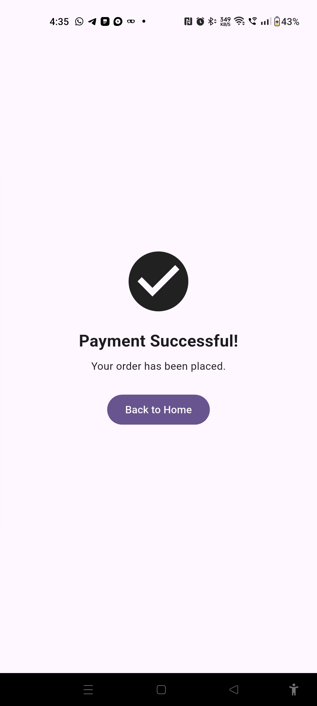

---

## 🎯 Key Highlights
- Cross-platform support (Android, iOS, Web)
- Real-time sync using Firestore
- Scalable architecture with Riverpod
- Reward-based wallet system for higher retention

---

## 📂 Project Structure

```
food_app/
│── lib/
│   ├── main.dart
|   ├── auth/
|   ├── core/
|   ├── features/
│   ├── models/
|   ├── services/
│   ├── settings/
│   ├── ui/
│   ├── widgets/
│── assets/
│── pubspec.yaml
│── README.md
```

---

## ⚡ How to Run

1. Clone the repository:
   ```bash
   git clone https://github.com/your-username/food-ordering-app.git
   cd food-ordering-app
   ```

2. Install dependencies:
   ```bash
   flutter pub get
   ```

3. Configure Firebase (add your `google-services.json` & `GoogleService-Info.plist`).

4. Run the app:
   ```bash
   flutter run
   ```

---

## 👨‍💻 Author

**Dhinakaran Kalaimani**  
📧 dhinadts@gmail.com  
🔗 [LinkedIn](https://www.linkedin.com/in/dhinakaran-kalaimani/)  

---

## 📜 License

This project is licensed under the MIT License - see the [LICENSE](LICENSE) file for details.
